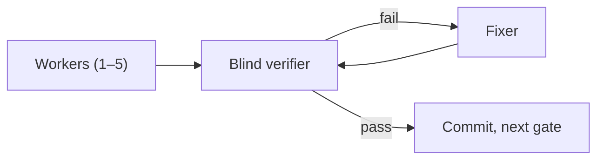

# cto-team

A Claude Code plugin that turns your AI coding agent into a multi-agent team: a CTO plans once, fresh subagents build gate by gate, and a blind verifier checks code review and test quality. Made for vibe coding that holds up.

[Landing page](https://cto-team-skill.pages.dev/) · [Tiếng Việt](README.vi.md)

## Install

Version 0.4.1. In Claude Code:

```
/plugin marketplace add nhattrung0911/cto-team
/plugin install cto-team@cto-team
```

- Optional: [superpowers](https://github.com/obra/superpowers) for planning. Without it, use `/cto-team:plan`.
- Optional: Playwright MCP, so the verifier can check web pages in a real browser. Without it, UI checks fall back to the project's own E2E tests or are reported as `UNVERIFIED`.

## What changes

| Feature | Before | After with cto-team |
|---|---|---|
| CTO plans once, then delivers gate by gate | One agent gets the whole plan and drifts | Workers get one brief each; the next gate starts only after this one passes |
| Contract-first API | Frontend and backend each guess the API | One contract file the CTO owns; workers may not edit it; the verifier checks the app against it |
| The CTO splits the team | You hand-assign agents; two agents edit the same file | You pick 1–5 Sonnet workers per gate; the CTO gives each disjoint files |
| Blind verifier on every gate | "Tests pass", says the agent that wrote them | A separate agent proves every acceptance criterion, runs the full suite, and breaks one line the tests must catch |
| No fake tests, no 500s | `assert True` slips through; huge input crashes | Fake tests fail the gate; every number gets an overflow test (v0.1 crashed on a 20-digit amount; fixed from v0.2) |
| Opus batch review | Bugs across features are found by users | Every 3–4 gates Opus reviews the batch (found a real race condition the per-gate checks missed) |
| Lean on tokens | Long-lived "member" agents grow huge | Every agent is one-shot and starts small; Sonnet does most of the work (12k vs 42k start context; 0.9M vs 3.8M tokens per agent) |
| ripgrep instead of grep | Slow recursive grep, noisy output | A hook points agents to ripgrep (faster, respects .gitignore) |
| Picks up after a reset | Context reset = redo or lost work | State lives in `docs/cto/`; delivery resumes from the last checkpoint |
| Report a non-coder can read | A long chat log | One HTML report: what works, how to try it, tech stack, architecture diagram, known gaps |

One gate:



## Use

1. Plan once: describe your idea (with superpowers) or run `/cto-team:plan`.
2. Run `/clear`. The plan is saved on disk, so nothing is lost.
3. Run `/cto-team:deliver <your-plan>.md`. You pick how many Sonnet workers per gate (1–5, default 3).

## FAQ

- **Does it replace superpowers?** No. superpowers is optional and only helps with planning; `/cto-team:plan` works without it.
- **What does it cost?** Every agent is one-shot and starts small, and Sonnet does most of the work. You choose the workers per gate.
- **Can I use it without Playwright?** Yes. UI checks fall back to the project's E2E tests or are reported as `UNVERIFIED`.
- **How many workers?** 1–5 per gate, default 3.

## What lands in your project

```
docs/cto/              gate map, briefs, verifier results, ledger, tech debt, report.html
docs/contract/         the API contract (only the CTO edits it)
```

## Settings and notes

Optional, copy yourself into `~/.claude/settings.json`. The plugin never changes your settings.

```json
{
  "env": {
    "CLAUDE_CODE_AUTO_COMPACT_WINDOW": "500000",
    "CLAUDE_CODE_SUBAGENT_MODEL": "sonnet",
    "CLAUDE_CODE_WORKFLOW_MAX_CONCURRENT_AGENTS": "6",
    "BASH_MAX_OUTPUT_LENGTH": "15000"
  },
  "workflowSizeGuideline": "medium"
}
```

- The ripgrep hook only acts inside cto-team projects. It is a convenience, not a security boundary: an unusual command (an alias, `env grep`, a nested shell) can slip past it.
- Workers and checkers run as the plugin's lean agents with only the tools their role needs. Checkers have no Edit tool and are told never to change source. This is an instruction boundary, not a permission sandbox: they still have shell access.
- Tested with Claude Code 2.1.301 (needs the Workflow tool and plugin agents).

## Credits

Ideas adapted from [obra/superpowers](https://github.com/obra/superpowers) and [olsenbrands/fable-foreman](https://github.com/olsenbrands/fable-foreman), both MIT. See `NOTICE`.

License: MIT.
