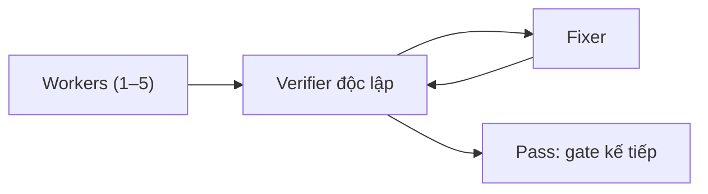

# cto-team

Claude Code plugin biến Claude thành CTO điều phối một đội AI coding agent: multi-agent, subagents, mỗi gate đều được review độc lập, để vibe coding cho ra kết quả đáng tin.

[Landing page](https://cto-team-skill.pages.dev/vi/) · [English](README.md)

## Cài đặt

Trong Claude Code:

```
/plugin marketplace add nhattrung0911/cto-team
/plugin install cto-team@cto-team
```

- Tùy chọn: [superpowers](https://github.com/obra/superpowers) để lên plan (không có thì dùng `/cto-team:plan`).
- Tùy chọn: Playwright MCP để verifier kiểm tra trang web trên trình duyệt thật.

## Thay đổi gì

| Tính năng | Trước đây | Với cto-team |
|---|---|---|
| CTO lên plan một lần, giao việc theo từng gate | Một agent nhận cả plan rồi đi lạc hướng | Mỗi worker nhận một brief riêng; gate kế tiếp chỉ bắt đầu sau khi gate này pass |
| Contract-first API | Frontend và backend mỗi bên tự đoán API | Một file contract do CTO giữ, worker không được sửa; verifier kiểm tra app theo contract đó |
| CTO tự chia team | Bạn tự giao việc cho agent; hai agent sửa cùng một file | Bạn chọn 1–5 worker Sonnet mỗi gate; CTO giao cho mỗi worker các file không trùng nhau |
| Verifier độc lập ở mọi gate | Agent viết test rồi tự báo "test pass" | Một agent riêng chứng minh từng tiêu chí nghiệm thu, chạy toàn bộ test suite, và phá một dòng code mà test phải bắt được |
| Không test giả, không lỗi 500 | `assert True` lọt qua; input quá lớn làm app crash | Test giả làm gate fail; mọi con số đều có test tràn số (v0.1 crash với số tiền 20 chữ số; sửa từ v0.2) |
| Opus review theo đợt | Lỗi nằm giữa các tính năng do người dùng tự tìm ra | Cứ 3–4 gate, Opus review cả đợt (tìm ra một race condition thật mà các kiểm tra theo từng gate bỏ sót) |
| Tiết kiệm token | Agent "thành viên" sống lâu ngày càng phình to | Mỗi agent chạy một lần và bắt đầu gọn nhẹ; Sonnet làm phần lớn việc (12k vs 42k context lúc khởi động; 0.9M vs 3.8M token mỗi agent) |
| ripgrep thay cho grep | grep đệ quy chậm, output nhiễu | Một hook hướng agent sang ripgrep (nhanh hơn, tôn trọng .gitignore) |
| Làm tiếp sau khi reset | Context bị reset là phải làm lại hoặc mất việc | Trạng thái nằm trong `docs/cto/`; delivery tiếp tục từ checkpoint gần nhất |
| Báo cáo người không code cũng đọc được | Một đoạn chat log dài | Một báo cáo HTML: cái gì chạy được, cách thử, tech stack, sơ đồ kiến trúc, những chỗ còn thiếu |



## Cách dùng

1. Lên plan một lần với CTO: `/cto-team:plan` (hoặc mô tả ý tưởng nếu đã có superpowers).
2. Xóa context: `/clear`. Plan đã lưu trên đĩa nên không mất gì.
3. Giao việc: `/cto-team:deliver <plan>`. Bạn chọn 1–5 worker mỗi gate, mặc định là 3.

## Hỏi đáp

- **Có thay thế superpowers không?** Không. superpowers dùng để lên plan; cto-team lo phần giao việc và kiểm tra.
- **Chi phí thế nào?** Mỗi agent chạy một lần và khởi động gọn, Sonnet làm phần lớn việc nên token được tiết kiệm.
- **Không có Playwright MCP thì sao?** Vẫn chạy được; verifier dùng E2E test của project hoặc ghi rõ là `UNVERIFIED`.
- **Nên chọn bao nhiêu worker?** Từ 1 đến 5 mỗi gate, mặc định 3.

## Những gì xuất hiện trong project

```
docs/cto/        gate map, brief, kết quả verifier, ledger, báo cáo report.html
docs/contract/   contract của API (chỉ CTO được sửa)
```

## Settings gợi ý

Plugin không tự đổi settings của bạn. Nếu muốn, thêm vào `~/.claude/settings.json` (đã test với Claude Code 2.1.301):

```json
{
  "env": {
    "CLAUDE_CODE_AUTO_COMPACT_WINDOW": "500000",
    "CLAUDE_CODE_SUBAGENT_MODEL": "sonnet"
  }
}
```

## Credits

Ý tưởng điều chỉnh từ [obra/superpowers](https://github.com/obra/superpowers). License MIT. Phiên bản 0.4.0.
